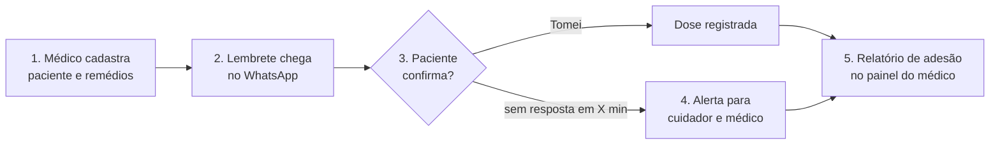
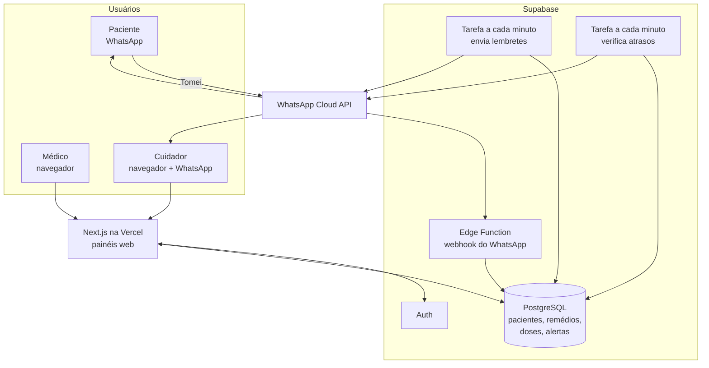

# Cuidar+

O Cuidar+ conecta **médicos, pacientes idosos e cuidadores** para garantir que o tratamento seja seguido. O paciente recebe o lembrete do remédio pelo **WhatsApp** e confirma com um toque. Se não confirmar a tempo, o cuidador e o médico são avisados.

Projeto desenvolvido na jornada **SuperNova** (6 semanas).

---

## Sumário

- [O problema](#o-problema)
- [A solução](#a-solução)
- [Fluxo do MVP](#fluxo-do-mvp)
- [Mockup](#mockup)
- [Stack](#stack)
- [Arquitetura](#arquitetura)
- [Estrutura do repositório](#estrutura-do-repositório)
- [Como trabalhamos](#como-trabalhamos)
- [Cronograma](#cronograma)
- [Entregáveis](#entregáveis)
- [Equipe](#equipe)

---

## O problema

- Cerca de **50% dos idosos** não seguem corretamente suas prescrições.
- A **polifarmácia** (vários remédios ao mesmo tempo) aumenta o risco de confusão e erro.
- O declínio cognitivo dificulta lembrar horários e doses.
- Os apps de lembrete existentes **não se conectam ao médico**: ninguém sabe se o paciente realmente tomou o remédio.
- Em doenças crônicas (diabetes, hipertensão, anticoagulantes), esquecer uma dose pode ser grave.

## A solução

| Ator | Interface | O que faz |
|---|---|---|
| **Médico** | Painel web | Cadastra pacientes e medicamentos, vê relatórios de adesão e recebe alertas de não adesão |
| **Paciente (idoso)** | WhatsApp (app opcional) | Recebe lembretes e confirma que tomou com um toque |
| **Cuidador / familiar** | Painel web + WhatsApp | Acompanha a adesão e recebe alertas quando algo está errado |

**Diferencial:** o Cuidar+ inclui o cuidador no ecossistema. Soluções como o AMPA conectam médico e paciente; o Cuidar+ conecta **médico, paciente e cuidador**.

**Diferenciais extras (depois do MVP):**
- Leitura de receita por foto (OCR + IA) para preencher o cadastro automaticamente.
- Análise de padrões de esquecimento (ex.: "sempre esquece o remédio da tarde").

## Fluxo do MVP



## Mockup

Protótipo navegável com as telas dos três atores e a simulação do fluxo completo:
[`mockup/index.html`](mockup/index.html). Baixe o arquivo e abra no navegador.

Cada tela do mockup mostra a user story correspondente e as primeiras tasks de implementação.

## Stack

Tudo escolhido para funcionar **sem custo** durante o desenvolvimento e a demo.

| Componente | Tecnologia | Por quê |
|---|---|---|
| Painéis do médico e do cuidador | **Next.js** (React + TypeScript) | Sugerido no documento do projeto; um só projeto web para os dois painéis |
| Login | **Supabase Auth** | Login pronto, plano gratuito sem cartão de crédito |
| Banco de dados | **Supabase (PostgreSQL)** | Citado no documento; tempo real no painel (o alerta aparece sem recarregar) |
| Agendador e webhook | **pg_cron + Supabase Edge Functions** | Tarefa a cada minuto para enviar lembretes e verificar atrasos; endpoint HTTP para receber as respostas do WhatsApp |
| Mensagens | **WhatsApp Cloud API** (Meta) | Lembretes com botões "Tomei" e "Me lembra em 15 min" |
| Hospedagem web | **Vercel** (plano gratuito) | Deploy automático do Next.js a cada push |
| Leitura de receita (extra) | OCR + LLM | Diferencial, fica para depois do MVP |

Observações:
- A WhatsApp Cloud API tem um **número de teste gratuito** da Meta que envia mensagens para até 5 números cadastrados, o que basta para a demo. Não é preciso comprar um número.
- Em produção, a Meta cobra por mensagem entregue (lembretes custam frações de centavo de dólar) e é preciso um número próprio, que não esteja em uso no app do WhatsApp.
- Mensagens iniciadas pelo sistema (o lembrete) precisam de um **modelo de mensagem aprovado pela Meta**. A aprovação pode levar alguns dias, então esse cadastro é feito logo na semana 1.

## Arquitetura



**Estados de uma dose:** `agendada` → `enviada` → `tomada` (ou `atrasada` → `tomada_atrasada` / `perdida`).

## Estrutura do repositório

Estrutura planejada:

```
.
├── mockup/        # protótipo navegável (HTML)
├── web/           # Next.js: painéis do médico e do cuidador
├── supabase/      # tabelas, políticas de acesso, agendador e webhook do WhatsApp
├── docs/          # backlog, modelo de dados e decisões
└── README.md
```

## Como trabalhamos

Usamos o **GitHub Projects** com quatro colunas:

| Coluna | Significado |
|---|---|
| **Backlog** | Tudo que já foi identificado, ainda sem semana definida |
| **Todo** | Tarefas escolhidas para a semana atual |
| **Andamento** | Alguém está trabalhando nela agora (no máximo uma por pessoa) |
| **Feito** | Concluída, revisada e na branch `main` |

Combinados:
- Cada tarefa vira uma issue pequena (de meio dia a dois dias de trabalho).
- Uma branch por issue: `tipo/numero-descricao`, por exemplo `feat/12-formulario-medicamento`.
- Toda mudança entra por pull request com pelo menos uma revisão.
- Uma tarefa só vai para **Feito** quando cumpre o critério de pronto escrito na issue.

O backlog inicial, com as tarefas separadas por épico, está em [`docs/BACKLOG.md`](docs/BACKLOG.md).

## Cronograma

| Semana | Foco |
|---|---|
| 1 | Escopo, pesquisa com médicos e cuidadores, setup do projeto, cadastro na Meta |
| 2 | Protótipo (mockup), modelo de dados, login e cadastro de pacientes |
| 3 | Backend e banco: cadastro de remédios, geração de doses, envio de lembretes |
| 4 | Painéis web do médico e do cuidador |
| 5 | Integração completa com o WhatsApp (respostas e alertas) e testes |
| 6 | Ajustes finais, dados de demonstração e vídeo-pitch |

## Entregáveis

| Entregável | Descrição | Prazo |
|---|---|---|
| Protótipo (MVP) | Fluxo completo: cadastro → lembrete → confirmação → alerta | Durante a jornada |
| Business Model Canvas | Modelo de negócio preenchido | Durante a jornada |
| Vídeo-pitch | Apresentação de 3 minutos | Final da jornada |

## Equipe

- Júllia Fernandes
- Anna Laura Moura
