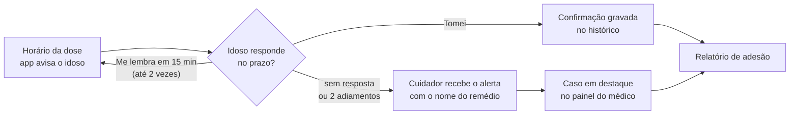
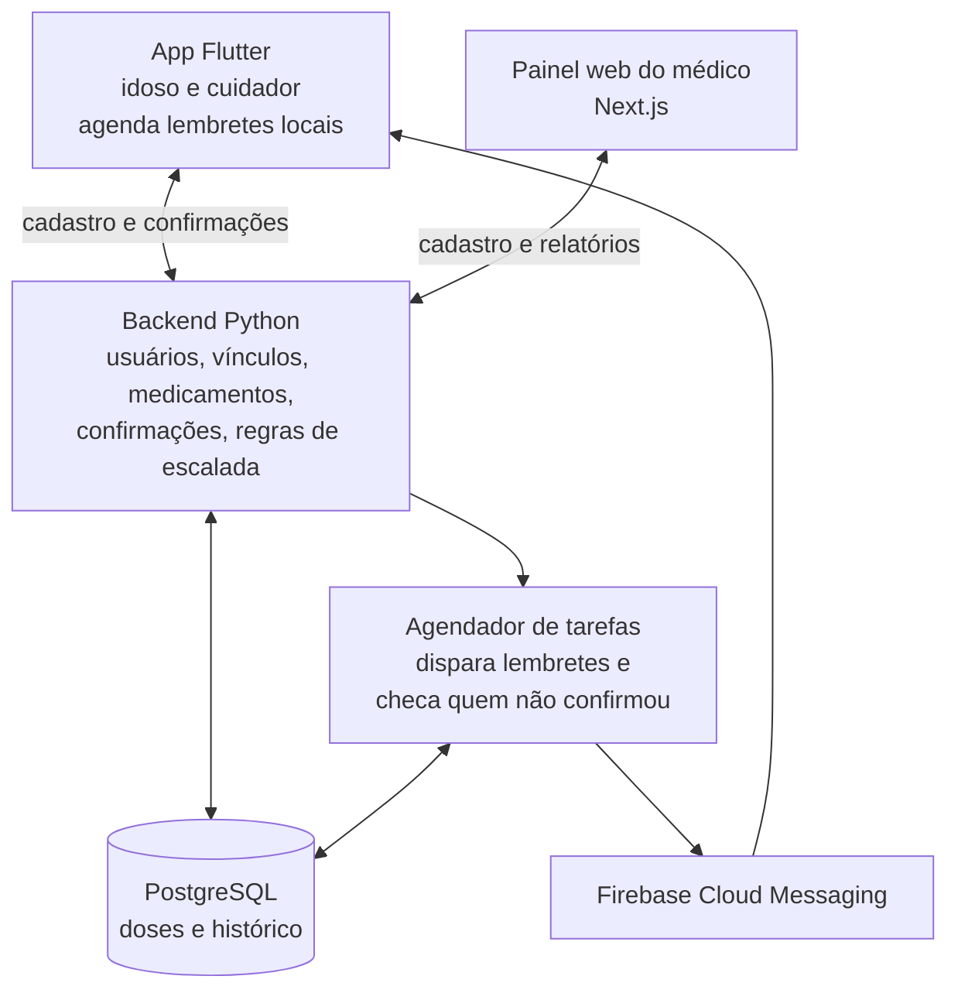

# Cuidar+

O Cuidar+ é um aplicativo que conecta **idosos, cuidadores e médicos** para garantir que cada medicamento seja tomado no horário certo e que alguém aja quando não for.

- **Idoso:** recebe os lembretes em um chat dentro do app e confirma com um toque.
- **Cuidador:** é avisado na hora quando o idoso não confirma.
- **Médico:** acompanha a adesão real dos pacientes em um painel web, sem receber notificações.

Os lembretes saem do próprio app (notificações push), sem custo por mensagem. Idosos que não usam o aplicativo são acompanhados pelo cuidador, que recebe o lembrete no lugar deles.

Projeto desenvolvido na jornada **SuperNova** (6 semanas). Documento completo: [`docs/Cuidar_Documento_do_Projeto_v2.pdf`](docs/Cuidar_Documento_do_Projeto_v2.pdf).

> **Onde estamos:** o [protótipo](prototipo/) (desenho das telas) está pronto, e o app do [MVP](MVP/) já tem todas as telas e regras funcionando com dados de demonstração. Agora falta ligar o MVP a um banco, ao login de verdade, às notificações e ao site do médico. O que cada pasta guarda, o que já foi feito e o que falta está em [`docs/ETAPAS.md`](docs/ETAPAS.md).
>
> **Como abrir ou rodar cada pasta:** [`COMO-RODAR.md`](COMO-RODAR.md).

---

## Sumário

- [O problema](#o-problema)
- [A solução](#a-solução)
- [Fluxo e regras de escalada](#fluxo-e-regras-de-escalada)
- [Cadastro de medicamentos](#cadastro-de-medicamentos)
- [Escopo do MVP](#escopo-do-mvp)
- [Protótipo, MVP e landing page](#protótipo-mvp-e-landing-page)
- [Stack e arquitetura](#stack-e-arquitetura)
- [Estrutura do repositório](#estrutura-do-repositório)
- [Como trabalhamos](#como-trabalhamos)
- [Cronograma](#cronograma)
- [Decisões em aberto](#decisões-em-aberto)
- [Equipe](#equipe)

---

## O problema

Cerca de metade dos idosos não segue corretamente as prescrições médicas, e ninguém percebe a tempo.

- A **polifarmácia** (vários remédios ao mesmo tempo) aumenta o risco de confusão e erro.
- O declínio cognitivo dificulta a gestão da medicação.
- Os apps de lembrete existentes não se conectam ao médico nem à família: ninguém sabe se o paciente realmente tomou o remédio.
- O médico, com dezenas de pacientes, não consegue acompanhar a adesão de cada um entre as consultas.
- Em doenças crônicas (diabetes, hipertensão, anticoagulantes), esquecer doses pode ter consequências graves.

## A solução

Idosos e cuidadores usam o mesmo aplicativo (Flutter), cada um com seu perfil. O médico usa um painel web. Todos compartilham o mesmo backend e o mesmo histórico de adesão.

| Perfil | Onde | O que faz |
|---|---|---|
| **Idoso** | App | Chat de lembretes com **Tomei** e **Me lembra em 15 min**; lista do dia em letras grandes; cadastro de medicamentos |
| **Cuidador** | App | Lista dos idosos com o status do dia; alerta quando o idoso adia 2 vezes ou não responde; cadastro e edição de medicamentos; vínculo por código, com consentimento do idoso |
| **Médico** | Painel web | Pacientes por exceção (vermelho, amarelo, verde); relatório de adesão com mapa por período do dia; cadastro e edição de medicamentos; **sem notificações** |

**Idoso sem o aplicativo:** no cadastro, o cuidador marca se o idoso usa o app.
- **Com app:** cuidador e idoso se vinculam por um código, aceito dos dois lados.
- **Sem app:** o cuidador recebe, na aba daquele idoso, a mesma tela de lembretes e confirma as doses por ele. Enquanto a dose não for confirmada, recebe um aviso a cada 15 minutos. A confirmação fica registrada como feita pelo cuidador.

**Quem pode fazer o quê**

| Ação | Idoso | Cuidador | Médico |
|---|---|---|---|
| Receber lembrete e confirmar a dose | Sim | Só do idoso sem app, confirmando por ele | Não |
| Ver medicamentos e histórico | Os próprios | Dos idosos vinculados | Dos seus pacientes |
| Ver atrasos e qual medicamento | Os próprios | Sim, com alerta | Sim, no painel |
| Cadastrar e editar medicamentos | Sim | Sim | Sim |
| Relatório de adesão | Não | Histórico de 7 dias | Completo, com padrões |

## Fluxo e regras de escalada



- **Adiamento:** "Me lembra em 15 min" pode ser usado até 2 vezes. Depois do segundo, o cuidador é alertado.
- **Sem resposta:** se o idoso não toca em nada, o cuidador também recebe o aviso. O prazo ainda será definido.
- **Idoso sem app:** o cuidador recebe o lembrete na aba do idoso e é avisado a cada 15 minutos até confirmar.
- **Médico:** não é avisado em nenhum caso; acompanha tudo pelo painel.

## Cadastro de medicamentos

Idoso, cuidador e médico podem cadastrar medicamentos, e cada registro guarda quem o criou.

| Quem cadastra | Como aparece | O que acontece |
|---|---|---|
| Médico | Prescrição validada | Gera os lembretes e vale como versão de referência |
| Cuidador | Cadastrado pela família | Gera os lembretes; entra na fila de revisão do médico (depois do MVP) |
| Idoso | Cadastrado pelo paciente | Gera os lembretes; cuidador e médico são informados |

Cada medicamento guarda nome, dose, horários, dias da semana, início, fim, prazo para o alerta e origem. Toda alteração fica no histórico, e a versão do médico prevalece quando houver divergência.

## Escopo do MVP

O MVP precisa provar o ciclo completo: **cadastro, lembrete, confirmação, alerta e relatório**.

| Funcionalidade | Fase |
|---|---|
| Chat de lembretes do idoso (Tomei, Me lembra em 15 min, até 2 vezes) | MVP |
| Lembretes por push e agendamento local no aparelho | MVP |
| Alerta ao cuidador depois do segundo adiamento ou sem resposta | MVP |
| Cadastro do idoso com marcação de uso do app e vínculo por código | MVP |
| Idoso sem app: cuidador recebe a tela do idoso e confirma por ele | MVP |
| Painel do cuidador: status do dia, atrasos, medicamentos de cada idoso | MVP |
| Cadastro de medicamentos por médico, cuidador e idoso, com origem registrada | MVP |
| Painel do médico: lista de pacientes, painel por exceção, relatório de adesão | MVP |
| Fila de revisão dos medicamentos cadastrados por família e idoso | Depois |
| Cadastro por foto da receita (OCR + NLP) | Depois |
| Detecção de padrões de esquecimento | Depois |
| Checagem de alergias e controle de estoque | Depois |

## Protótipo, MVP e landing page

- **Protótipo:** [`prototipo/index.html`](prototipo/index.html). Desenho navegável das telas dos três perfis, em HTML, com a simulação do lembrete e do alerta. Baixe e abra no navegador.
- **MVP:** [`MVP/`](MVP/). O app de verdade, em Flutter. Já tem todas as telas e regras funcionando com dados de demonstração; o banco, o login real e as notificações entram nas próximas semanas. Como rodar: [`MVP/README.md`](MVP/README.md).
- **Landing page:** [`landing-page/index.html`](landing-page/index.html). Página de apresentação do Cuidar+.

O backlog completo está em [`docs/BACKLOG.md`](docs/BACKLOG.md).

## Stack e arquitetura

| Componente | Tecnologia | Papel |
|---|---|---|
| App do idoso e do cuidador | **Flutter** | Chat de lembretes, painel do cuidador; agenda lembretes locais no aparelho |
| Painel do médico | **Next.js** | Pacientes por exceção, relatórios, cadastro |
| Backend (API) | **Python** (FastAPI) | Usuários, vínculos, medicamentos, confirmações e regras de escalada |
| Banco de dados | **PostgreSQL** | Doses e histórico de adesão |
| Agendador de tarefas | Tarefa periódica do backend | Dispara os lembretes e verifica quem não confirmou |
| Push | **Firebase Cloud Messaging** | Notificações para idoso e cuidador, sem custo por mensagem |



O app combina push e lembretes agendados no próprio aparelho, para que o lembrete toque mesmo sem internet.

**Custo zero durante a jornada (proposta):**
- Firebase Cloud Messaging é gratuito e não exige cartão.
- PostgreSQL em um plano gratuito (por exemplo, Supabase ou Neon).
- Backend Python em hospedagem gratuita; o agendador pode ser acionado a cada minuto por um serviço de cron gratuito.
- App testado em **Android**. Publicar para iPhone exige conta de desenvolvedor da Apple (paga) e um Mac, então fica para depois.

**Estados de uma dose:** `agendada` → `lembrada` → `adiada` (até 2 vezes) → `tomada`, ou `alertada` → `tomada_apos_alerta` / `perdida`. Toda confirmação registra o horário real e quem confirmou (idoso ou cuidador).

## Estrutura do repositório

```
.
├── prototipo/     # desenho navegável das telas (HTML)
├── MVP/           # app em Flutter: idoso, cuidador e, por enquanto, o médico
├── landing-page/  # página de apresentação do Cuidar+
├── pesquisa/      # painel com as respostas do formulário e das entrevistas
├── docs/          # etapas, backlog e documento do projeto
│   └── antigo/    # versão anterior do documento (v1, com WhatsApp)
└── README.md
```

## Como trabalhamos

Usamos o **GitHub Projects** com quatro colunas:

| Coluna | Significado |
|---|---|
| **Backlog** | Tudo que já foi identificado, ainda sem semana definida |
| **Todo** | Tarefas escolhidas para a semana atual |
| **Andamento** | Alguém está trabalhando nela agora (no máximo uma por pessoa) |
| **Feito** | Concluída, revisada e na branch `main` |

Combinados:
- Cada tarefa vira uma issue pequena (de meio dia a dois dias de trabalho).
- Uma branch por issue: `tipo/numero-descricao`, por exemplo `feat/12-chat-lembretes`.
- Toda mudança entra por pull request, revisado pela outra pessoa.
- Uma tarefa só vai para **Feito** quando cumpre o critério de pronto escrito na issue.

## Cronograma

| Semana | Atividade |
|---|---|
| 1 | Definição do escopo; pesquisa com médicos e cuidadores, incluindo quando querem ser avisados; setup do projeto |
| 2 | Prototipação (app do idoso e do cuidador, painel do médico); modelo de dados; contas e vínculos |
| 3 | Backend, banco de dados e regras de escalada |
| 4 | App em Flutter (chat do idoso, painel do cuidador) e painel web do médico |
| 5 | Notificações (push e agendamento local), alerta ao cuidador e testes com usuários reais |
| 6 | Ajustes finais e gravação do vídeo-pitch |

A semana 4 é a mais apertada, porque app e painel web andam em paralelo. Por isso as frentes são divididas entre as duas pessoas desde a semana 1.

**Entregáveis do SuperNova:** protótipo (MVP) com o fluxo completo, Business Model Canvas e vídeo-pitch de 3 minutos.

## Decisões em aberto

- [ ] Prazo para alertar o cuidador quando o idoso com app não toca em nada.
- [ ] Conferir a fonte do dado de que cerca de 50% dos idosos não seguem as prescrições.
- [ ] Validar as regras de alerta com 2 ou 3 médicos e cuidadores na semana 1.
- [ ] Levar a um especialista, antes de operar, o consentimento de idoso que não decide por si e o enquadramento na Anvisa.

## Equipe

- Júllia Fernandes
- Anna Laura Moura
