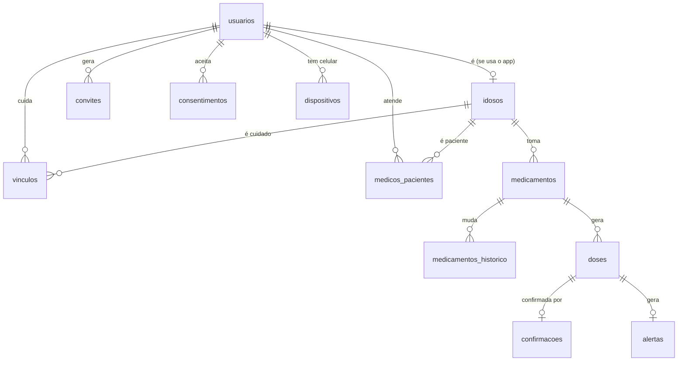
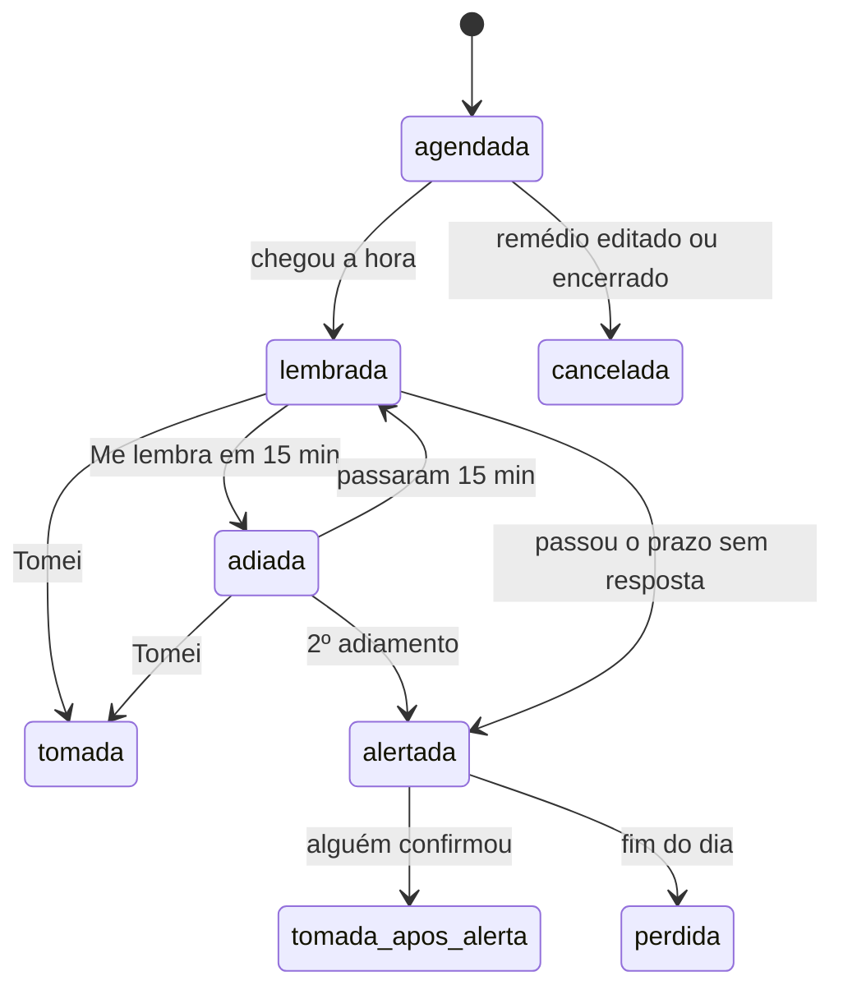

# Modelo de dados do MVP

Tarefa `SET-6` do [backlog](BACKLOG.md). Este documento explica as tabelas do banco (PostgreSQL),
e o arquivo [`modelo-de-dados.sql`](modelo-de-dados.sql) cria todas elas. As tabelas seguem o que o
app em [`MVP/`](../MVP/) já usa com dados de demonstração, então as telas não precisam mudar.

**Pronto quando:** as duas revisaram e aprovaram. Comentem no PR o que mudariam.

## Visão geral

São 11 tabelas, em quatro grupos:

| Grupo | Tabelas | Para quê |
|---|---|---|
| Pessoas | `usuarios`, `idosos`, `vinculos`, `convites`, `medicos_pacientes`, `consentimentos` | Quem é quem e quem pode ver o quê |
| Remédios | `medicamentos`, `medicamentos_historico` | O que o idoso toma e quem cadastrou ou mudou |
| Dia a dia | `doses`, `confirmacoes`, `alertas` | Cada horário, quem confirmou e quando o cuidador foi avisado |
| Notificações | `dispositivos` | Para qual celular mandar o push |

## Pessoas

### `usuarios`
Uma linha por pessoa que entra no app ou no painel: idoso com app, cuidador ou médico.

| Campo | O que guarda |
|---|---|
| `nome`, `email`, `telefone` | Dados da conta. O email não se repete (sem diferenciar maiúsculas) |
| `senha_hash` | A senha embaralhada. **Nunca** a senha em texto |
| `perfil` | `idoso`, `cuidador` ou `medico` |
| `detalhe` | Linha extra do perfil, como "Geriatria · CRM 123456" |

### `idosos`
A pessoa cuidada, com os dados de saúde. **Por que separada de `usuarios`?** Porque o idoso sem app
não tem conta: quem o cadastra é o cuidador.

| Campo | O que guarda |
|---|---|
| `usuario_id` | A conta do idoso. Vazio se ele não usa o app |
| `usa_app` | Calculado sozinho: `true` quando tem `usuario_id`. Ninguém precisa preencher |
| `nome`, `apelido` | "Maria Aparecida Silva" e "Dona Maria" |
| `data_nascimento`, `condicoes`, `telefone` | Usados nas telas do cuidador e do médico |
| `fuso_horario` | Para "08:00" ser 08:00 no relógio do idoso, mesmo em outro estado |
| `criado_por` | Quem cadastrou: o próprio idoso ou o cuidador |

Se um idoso sem app começar a usar o celular, basta criar a conta dele e ligar ao `usuario_id`. O
histórico continua o mesmo.

### `vinculos`
Liga um cuidador a um idoso. O parentesco fica guardado dos dois lados, como no app: o idoso vê
"Carla · Filha" e a cuidadora vê "Dona Maria · Mãe".

| Campo | O que guarda |
|---|---|
| `cuidador_e` / `idoso_e` | "Filha" / "Mãe" |
| `removido_em` | Quando o idoso tirou o acesso. A linha não é apagada, para manter o registro |

### `convites`
O código que o cuidador gera e o idoso com app digita (por exemplo, `RUI-482`).

- Vale por 24 horas (`expira_em`).
- O vínculo só nasce quando o idoso aceita (`aceito_em`). Ele também pode recusar (`recusado_em`).
- Idoso sem app não usa convite: o cuidador cadastra direto e o vínculo é criado na hora.

### `medicos_pacientes`
Liga o médico aos pacientes dele. Como ele adiciona o paciente (pelo email ou por um código) ainda
está em aberto (`AUTH-7`). A tabela serve para as duas formas.

### `consentimentos`
O aceite da LGPD no cadastro, com data e versão do texto aceito. Revogar não apaga a linha, só
preenche `revogado_em`, para ficar provado quando cada pessoa aceitou e quando desistiu.

## Remédios

### `medicamentos`

| Campo | O que guarda | Exemplo |
|---|---|---|
| `nome`, `dose` | Texto livre | "Losartana 50 mg", "1 comprimido" |
| `horarios` | Lista de horários | `{08:00, 20:00}` |
| `dias_semana` | 1 = segunda ... 7 = domingo | `{1,2,3,4,5,6,7}` |
| `inicio`, `fim` | Datas. `fim` vazio = uso contínuo | |
| `prazo_alerta_min` | Minutos sem resposta até avisar o cuidador | `30` |
| `origem` | `medico` (prescrição validada), `familia` ou `paciente`. Vem do perfil de quem cadastrou | |
| `criado_por` | Quem cadastrou | |
| `encerrado_em` | Quando o remédio foi suspenso. A linha fica, para o histórico | |

### `medicamentos_historico`
Toda criação, edição e encerramento, com a versão de antes e a de depois (em JSON). É daqui que sai
o "Alterado por Carla em 18/11" no relatório do médico.

## Dia a dia

### `doses`
Cada horário de cada dia vira uma linha: "Losartana às 08:00 de 20/11". A API gera os próximos 7
dias e completa todo dia (`MED-2`).

| Campo | O que guarda |
|---|---|
| `agendada_para` | Data e hora exatas |
| `estado` | Em que ponto a dose está (veja abaixo) |
| `adiamentos` | Quantas vezes tocou em "Me lembra em 15 min". O banco não deixa passar de 2 |
| `lembretes_enviados` | Quantos avisos já saíram. No idoso sem app, um a cada 15 minutos |
| `proximo_lembrete_em` | Quando o agendador deve olhar essa dose de novo |

**Estados da dose:**

No app, esses estados aparecem com os nomes que o protótipo já usa:

| No banco | No app |
|---|---|
| `agendada`, `lembrada` | Pendente |
| `adiada` | Adiada |
| `alertada` | Atrasada |
| `tomada`, `tomada_apos_alerta` | Tomada |
| `perdida` | Perdida |
| `cancelada` | Não aparece |

### `confirmacoes`
Quem confirmou a dose e quando. É separada de `doses` para o médico ver no relatório se foi o idoso
ou o cuidador. **Uma dose só pode ter uma confirmação:** o banco recusa a segunda, como o app já faz.

### `alertas`
O aviso ao cuidador: por que (`adiou_duas_vezes` ou `sem_resposta`), quando foi criado e quando foi
resolvido. No máximo um por dose. A tela de Alertas do cuidador e a lista "Precisam de atenção" do
médico saem daqui.

## Notificações

### `dispositivos`
O token do Firebase Cloud Messaging de cada celular, que o app envia depois do login. Uma pessoa pode
ter mais de um celular.

## Quem pode ver o quê (LGPD)

A API confere isto em toda rota (`AUTH-8`):

| Perfil | Pode ver e alterar |
|---|---|
| Idoso | Só os próprios dados (`idosos.usuario_id` = ele) |
| Cuidador | Só os idosos com um `vinculo` ativo (sem `removido_em`) |
| Médico | Só os pacientes em `medicos_pacientes` ativos |

## Decisões que ainda precisam de vocês

- [ ] **Login: fazer na API ou usar o Supabase Auth?** Este modelo guarda a senha em
  `usuarios.senha_hash` (login feito pela API). Com o Supabase Auth, esse campo sai e o
  `usuarios.id` passa a ser o id do usuário do Supabase. O resto não muda.
- [ ] **Prazo do alerta "sem resposta":** o protótipo usa 30 minutos por padrão, com opção de 15 ou 60.
- [ ] **Quando uma dose vira `perdida`:** a proposta é no fim do dia, ou na hora da próxima dose do mesmo remédio.
- [ ] **Médico e paciente (`AUTH-7`):** adicionar pelo email do paciente ou por um código do médico.
